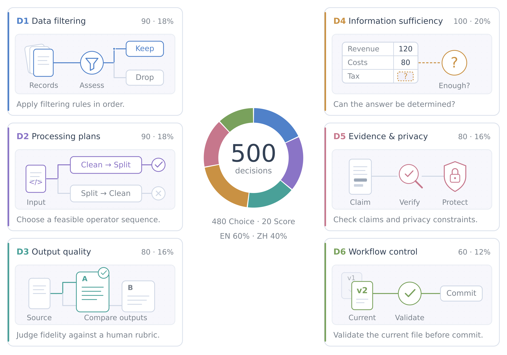

<h1 align="center">DataJevBench</h1>

<p align="center">
  <a href="README.md">English</a> ·
  <a href="README.zh-CN.md"><strong>简体中文</strong></a>
</p>

<p align="center">
  <a href="benchmark/README.md"></a>
  <a href="#测什么"></a>
  <a href="#评测结果"></a>
  <a href="https://github.com/datajuicer"></a>
  <a href="https://github.com/datajuicer/data-juicer"></a>
  <a href="LICENSE"></a>
</p>

<p align="center">
  <strong>面向数据工作流的决策能力评测。</strong><br>
  500 道题 · 6 个子集 · 中英双语 · v0.5
</p>

<p align="center">
  <a href="docs/design.md">任务设计</a> ·
  <a href="#评测结果">评测结果</a> ·
  <a href="#快速开始">快速开始</a> ·
  <a href="docs/CONTRIBUTING.md">贡献指南</a> ·
  <a href="#引用">引用</a>
</p>

---

DataJevBench 评估**数据工作流中的决策能力**：哪些记录应该保留、选择哪些处理步骤、如何判断产物质量、现有证据能否支持分析，以及下一步应该采取什么行动。

由 [**DataJuicer Team**](https://github.com/datajuicer) 开发，DataJevBench 通过统一的题目输入与评分规则，比较模型在各类数据决策中的优势与不足。[全部 500 道题及参考答案](benchmark/README.md)均已公开。

> [!NOTE]
> **部分评测集与算子由 [Data-Juicer](https://github.com/datajuicer/data-juicer) 提供支持。** 相关评测任务基于其数据处理算子及文档构建，将决策评测与实际数据工作流相结合。

## 为什么测这些决策？

数据质量取决于工作流中的一系列选择。过滤决定哪些材料进入数据集，处理方案决定材料如何转换，质量检查与证据判断决定产物是否可用、结论是否有据，工作流控制则把这些判断衔接到下一步行动。

这些选择要求模型综合已有材料、明确的规则、质量标准和当前工作流状态。下面的六个子集覆盖从数据准入到产物验证的决策点。

## 测什么？

[](assets/task-atlas.png)

| 子集 | 题数 | 占比 | 核心问题 |
| --- | ---: | ---: | --- |
| D1 · 多阶段数据准入 | 90 | 18% | 这条记录或这批数据是否符合收录规则？ |
| D2 · 数据处理方案选择 | 90 | 18% | 哪些现有操作能够满足处理要求？ |
| D3 · 数据产物质量评价 | 80 | 16% | 产物在给定质量标准下表现如何？ |
| D4 · 分析就绪与信息充分性 | 100 | 20% | 现有材料是否足以确定所需答案？ |
| D5 · 数据产物核验与披露审查 | 80 | 16% | 结论是否有证据支持，披露是否符合隐私规则？ |
| D6 · 数据任务执行控制 | 60 | 12% | 当前工作流状态下应该采取哪一步行动？ |

*插图和下面的例子以简化场景展示这六类决策。*

## 题目形式与覆盖范围

每道题提供三部分信息：

| 部分 | 内容 |
| --- | --- |
| **状态与材料** | 需要判断的记录、文档、表格、算子说明或工作流状态。 |
| **任务说明** | 要作出的决策，以及相应的规则或质量标准。 |
| **候选答案** | 可选择的答案标签，或按顺序排列的评分等级。 |

全集中有 **480 道选择题（96%）和 20 道有序评分题（4%）**。选择题涵盖二元判断、两两比较，以及从多项行动或处理方案中选择；评分题要求按给定标准选择对应等级。

指令语言为 **300 道英文（60%）和 200 道中文（40%）**。题目材料涵盖财报、科学论文、描述与摘要、处理算子及工作流状态。

## 怎样评分？

| 指标 | 含义 |
| --- | --- |
| Accuracy ↑ | 答对题数除以 500，每道题权重相同。 |
| D1–D6 Accuracy ↑ | 各子集的答对题数除以该子集题数。 |
| ECE10 ↓ | 将置信度分为十个区间，衡量置信度与实际准确率的一致程度。 |
| Brier ↓ | 对每题各候选答案的概率平方误差求和，再对题目取平均。 |

**总分**概括模型在完整题目分布上的表现；**子集分数**则展示处理方案选择、证据判断等具体能力。缺失或无效答案在 Accuracy 中计零分。全部 500 道题具有有效概率输出时，报告 ECE10 和 Brier。

v0.5 的概率和容差为 **`1e-3`**，通过校验的概率按返回值直接评分。

## 评测结果

每个模型按全部 500 道题统计。结果采用各模型记录的推理配置与 v0.5 评分器，按**总 Accuracy** 排序，同分并列。

<!-- results:start -->

评测快照: **2026-10-28**

| 名次 | 模型 | Accuracy ↑ | 有效回答 | ECE10 ↓ | Brier ↓ |
| ---: | --- | ---: | ---: | ---: | ---: |
| 1 | vLLM-SR d3-ultra | 83.4% | 500/500 | 0.0669 | 0.2405 |
| 2 | AutoTrust-JEV-27B v1.1 | 82.4% | 500/500 | 0.0465 | 0.2341 |
| 2 | GLiDE | 82.4% | 500/500 | 0.0309 | 0.2404 |
| 4 | vLLM-SR d3 (27B) | 81.6% | 500/500 | 0.0311 | 0.2477 |
| 5 | Mammoth-1 | 80.6% | 500/500 | 0.0483 | 0.2744 |
| 6 | Perplexity Decider v1.2 (27B) | 80.2% | 500/500 | 0.0431 | 0.2783 |
| 7 | StartLux Decision v1.1 27B Instant | 78.8% | 500/500 | 0.0442 | 0.2592 |
| 8 | Mercury Decide (Inception) | 78.4% | 500/500 | 0.1416 | 0.3600 |
| 9 | Jeffan-31B-1710 | 74.4% | 500/500 | 0.0827 | 0.3731 |
| 10 | Jev 1.14 | 73.8% | 476/500 | — | — |
| 11 | Cloudflare Clef (27B) | 73.6% | 500/500 | 0.0787 | 0.3670 |
| 12 | Microsoft Decision-1 | 72.6% | 500/500 | 0.0948 | 0.3797 |
| 13 | GPT-6 Luna Decisions | 71.2% | 500/500 | 0.1047 | 0.4162 |
| 14 | Strands Decider 26B-A4B (Gemma 4) | 60.6% | 500/500 | 0.0779 | 0.4873 |

<!-- results:end -->

有效回答列展示 500 道题中的有效输出数；横线表示该校准指标需要完整概率覆盖。结果快照同时记录 D1–D6 分数、模型配置、版本和证据哈希。

## 快速开始

Python 3.10+ 即可运行资产校验、HTTP 客户端和评分；模型推理使用模型自己的运行环境。从仓库根目录执行：

```bash
python -m pip install -e .
python -m datajevbench doctor \
  --engine datajevbench.engines:create_http \
  --engine-options configs/systemone.example.json --model-id your-model
```

`doctor` 只检查配置，不调用模型。题目与参考答案位于 `benchmark/records.jsonl`，对应的无答案输入位于 `benchmark/inputs.jsonl`。校验已包含的公开数据：

```bash
python -m datajevbench verify
```

运行评测前，按[部署说明](docs/deployment.md)配置模型服务和本地 JSON 文件，再使用[完整运行命令](docs/quickstart.md)。HTTP 使用 `/v1/systemone`，也支持 Python `module:factory` adapter。新模型可先用 `--limit 2` 做诊断，完整运行另选输出目录。

已有 `predict(state, questions)` 接口的模型可直接使用[统一适配层](docs/deployment.md#existing-model-implementations-with-predict)。模型运行代码和依赖留在模型环境中；适配层保留原始返回值，按冻结规则转换 Choice/Score，并记录外部源码哈希供续跑检查。

每次运行保存 `environment.json` 和 `results.jsonl`；对已有运行评分：

```bash
python -m datajevbench score --run runs/your-model-v05
```

评分写入 `scores.json`，不调用模型。`run --resume` 在资产与配置一致时重试未完成或失败的任务，保留全部尝试记录。

## 贡献与复现

提交新成绩时，请在本仓库开一个 **Issue**，附上模型/checkpoint、`scores.json`、推理配置和代码版本。代码修改前运行：

```bash
PYTHONDONTWRITEBYTECODE=1 python scripts/check_repo.py
```

[results/leaderboard.json](results/leaderboard.json) 是 README 表格和网站的唯一成绩数据源。当前源码不含历史逐题预测；检查表格一致性不等于重放历史成绩。已有成绩保留原始数据哈希，本次公开 ID 转换没有重新运行模型。详见[复现说明](docs/reproducibility.md)。

## 数据与许可证

题目数据中项目自有的贡献采用 [MIT](LICENSE)，第三方来源材料继续适用各自的条款与署名，见[来源说明](releases/v0.5/source-notices.md)。项目自身的代码、文档和插图尚待所有者确定许可证，数据许可不自动覆盖这些文件。署名声明保留在 [NOTICE](docs/NOTICE)。500 题及参考答案已包含在仓库中；[数据说明](benchmark/README.md)列出文件结构和哈希校验要求，[发布说明](docs/data-publication.md)记录 ID 与元数据的规范化方式。

## 仓库导航

- **评测集：** [任务设计](docs/design.md) · [数据目录](benchmark/README.md) · [v0.5 元数据](docs/release.md)
- **运行评测：** [运行指南](docs/quickstart.md) · [模型部署](docs/deployment.md) · [评分协议](docs/protocol.md)
- **结果与发布：** [结果数据](results/leaderboard.json) · [复现说明](docs/reproducibility.md) · [源码清单](releases/publication.json) · [网站预览](docs/CONTRIBUTING.md#site-and-illustration)

## 引用

```bibtex
@misc{datajevbench,
  title = {DataJevBench: Evaluating Decisions in Data Workflows},
  author = {{Data-Juicer Team}},
  year = {2026},
  url = {https://github.com/datajuicer/DataJevBench},
  note = {Benchmark v0.5}
}
```
